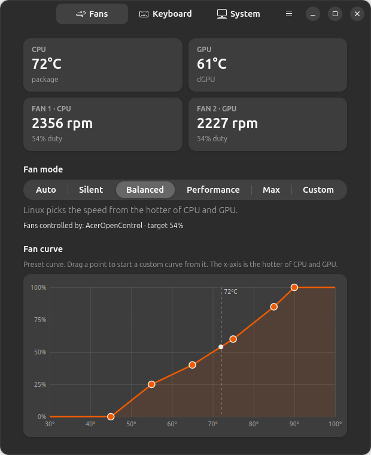
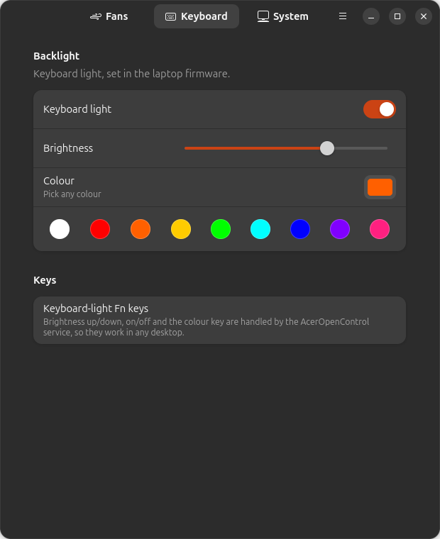
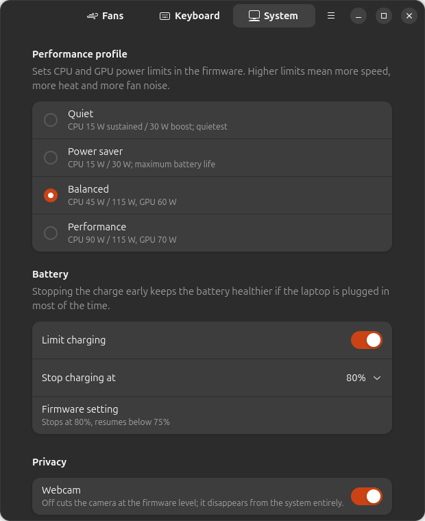

# AcerOpenControl

Fan curves, keyboard backlight, performance profiles, battery charge limit, webcam
switch and Fn hotkeys for **Clevo-based Acer laptops on Linux**, in the spirit of
the vendor control apps on Windows.

> **Unofficial project.** AcerOpenControl is not affiliated with, endorsed by or
> supported by Acer Inc. It talks to your laptop's firmware directly; read
> [Safety](#safety) before installing.



| | |
|---|---|
|  |  |

## Features

- **Fan control**: BIOS automatic, Silent, Balanced, Performance, Max, or your own
  curve drawn in the GUI. The curve follows the hotter of CPU and GPU, with
  hysteresis so the fans don't pulse, and it never wakes a sleeping GPU.
- **Fail-safes**: fans go to 100% at 92 °C CPU / 85 °C GPU. The BIOS takes back
  control if a sensor fails, the firmware stops answering, or the service stops,
  even if it is killed.
- **Keyboard backlight**: colour and brightness (RGB models), with working Fn keys.
- **Performance profiles**: the firmware's power-limit modes (for example 45 W ↔ 90 W CPU).
- **Battery charge limit**: stop charging at 60/70/80/90% to extend battery life.
- **Webcam kill switch**: powers the camera off in the firmware.
- **Fn hotkeys**: touchpad, camera and keyboard-light keys that do nothing on stock Linux.
- **GTK4 app, CLI and system service**: settings survive reboots and suspend.
- **CoolerControl plugin**: drive the fans from [CoolerControl](docs/COOLERCONTROL.md),
  with AcerOpenControl's fail-safes still in place.
- **Model profiles**: support for a laptop is a TOML file, not code. [Add yours](docs/ADDING_A_MODEL.md).

## Supported laptops

| Model | Platform | Status |
|---|---|---|
| Acer Aspire 7 A715-79G | Clevo NP50RN | ✅ verified |

Other Acer laptops built on Clevo boards probably work with a new profile. Run
`aocctl profiles list` after installing: if it reports the **Clevo WMI interface:
present**, follow [ADDING_A_MODEL.md](docs/ADDING_A_MODEL.md). Laptops without it
(most Nitro/Predator models, which use `acer-wmi`) are not supported.

## Install (Ubuntu 24.04 or newer)

```sh
curl -fsSL https://narendra5155.github.io/AcerOpenControl/key.gpg \
  | sudo tee /usr/share/keyrings/acer-open-control.gpg >/dev/null
echo "deb [signed-by=/usr/share/keyrings/acer-open-control.gpg] https://narendra5155.github.io/AcerOpenControl stable main" \
  | sudo tee /etc/apt/sources.list.d/acer-open-control.list
sudo apt update
sudo apt install acer-open-control-gtk
```

Then open **AcerOpenControl** from the app grid. Updates arrive with `sudo apt upgrade`.

If **Secure Boot** is on, the `acpi_call` kernel module needs a one-time key
enrolment. See [INSTALL.md](docs/INSTALL.md), which also covers installing a
single `.deb`, headless installs and uninstalling.

## Quick CLI tour

```sh
aocctl status                         # temperatures, fan rpm, mode, features
aocctl mode silent                    # auto | silent | balanced | performance | max | custom
aocctl curve 50:0 65:30 80:70 90:100  # your own curve (switches to custom)
aocctl kbd --color orange --brightness 180
aocctl profile performance            # firmware power profile
aocctl charge 80                      # stop charging at 80 %  (aocctl charge off)
aocctl webcam off
```

Any account in the `sudo` group can change settings; there's no need to re-login after installing.
See [USAGE.md](docs/USAGE.md) for everything else.

## Safety

AcerOpenControl changes fan speeds and power limits through the same firmware
interface the vendor's Windows software uses. It only exposes functions that were
verified on real hardware, keeps the fail-safes above, and refuses to write to the
firmware at all on a laptop no profile matches (it then shows temperatures only).
Still, you use it at your own risk: setting a silent curve on a laptop under heavy
load will make it run hot. To return everything to stock, run `sudo apt remove acer-open-control`
(the fans are handed back to the BIOS on removal).

## Documentation

| | |
|---|---|
| [INSTALL](docs/INSTALL.md) | APT, .deb, from source, Secure Boot, uninstall |
| [USAGE](docs/USAGE.md) | GUI, CLI, hotkeys, configuration file |
| [TROUBLESHOOTING](docs/TROUBLESHOOTING.md) | Common problems and how to collect logs |
| [COOLERCONTROL](docs/COOLERCONTROL.md) | Use the fans from CoolerControl |
| [ADDING_A_MODEL](docs/ADDING_A_MODEL.md) | Probe your laptop and write a model profile |
| [HARDWARE](docs/HARDWARE.md) | What the firmware interface does, command by command |
| [ARCHITECTURE](docs/ARCHITECTURE.md) | How the pieces fit together |
| [PROTOCOL](docs/PROTOCOL.md) | The daemon's socket API, for writing other frontends |
| [BUILDING](docs/BUILDING.md) | Toolchain, tests, running from a checkout |
| [RELEASING](docs/RELEASING.md) | Publishing a release and the APT repository |

## Contributing

Bug reports, model profiles and fixes are welcome. Read [CONTRIBUTING.md](CONTRIBUTING.md).
Security issues: see [SECURITY.md](SECURITY.md).

## License

GPL-3.0-or-later. See [LICENSE](LICENSE). Acer and Aspire are trademarks of Acer Inc.,
used here only to describe hardware compatibility.
