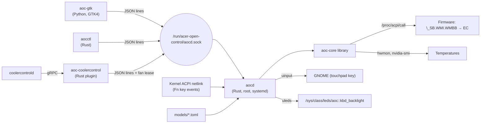

# Architecture

## Repository layout

| Path | What |
|---|---|
| `backend/aoc-core` | Library: ACPI calls, EC access, fan curves, sensors, features, hotkey plumbing, model profiles, config |
| `backend/aocd` | The daemon: control loop, request handler, permissions, socket server |
| `backend/aocctl` | CLI client and the root-only probe tools |
| `backend/aoc-coolercontrol` | CoolerControl device-service plugin (gRPC ↔ aocd) |
| `frontend/aoc_gtk` | GTK4/libadwaita window (Python) |
| `models/` | Model profiles shipped in the package |
| `packaging/` | systemd unit, sleep hook, maintainer scripts, `.deb` and APT repository scripts |
| `research/` | Probe results from real hardware (no raw ACPI dumps) |

## aoc-core

| Module | Role |
|---|---|
| `acpi` | `Firmware` trait; `AcpiCall` (writes `/proc/acpi/call` under an `flock`, so the daemon and the CLI never interleave); argument encoding and reply parsing |
| `ec` | `Clevo`: `get`/`set` with echo checking, EC RAM reads, fan duty, auto mode, RPM decoding |
| `features` | keyboard, performance profile, charge limit, webcam |
| `curve` | presets, `Curve` (linear interpolation), `Controller` (hysteresis, ramp, floor) |
| `sensors` | CPU from `coretemp` (found by name); GPU through `nvidia-smi`, skipped while the GPU is runtime-suspended |
| `profile` | TOML schema, validation, loading (`/usr/share/…/models` then `/etc/…/models.d`), DMI + WMI matching |
| `hotkeys` | genetlink `acpi_event` subscriber, uinput virtual keyboard, enable/read helpers |
| `kbd_led` | `uleds` LED so UPower and GNOME see a keyboard backlight |
| `config` | `/etc/acer-open-control/config.json`, written atomically |
| `fake` | firmware emulator used by tests and `aocd --fake` |

Every model-specific number comes from the profile; the code has no hard-coded command ids.

## aocd

**Threads:**

- **main:** runs the control loop every `poll_interval` seconds.
- **server:** accepts socket connections and starts one thread per client.
- **hotkeys:** blocks on netlink.
- **kbd-led:** blocks on `/dev/uleds`.

They all share one `Mutex<Service>`, so every state change is serialised.

**One control step (`Service::tick`):**

1. Watch for charger changes.
2. Read temperatures and fan state.
3. Refresh the feature state every 5th step.
4. Work out the target duty:
   - **Auto mode:** hand the fans to the BIOS.
   - **CPU temperature missing:** after 3 misses, hand the fans to the BIOS.
   - **Emergency or Max mode:** 100%.
   - **Otherwise:** the controller's output for max(CPU, GPU).
5. Send the duty only when it changes, or every `refresh_interval` seconds.

**Fail-safe layers:**

1. Emergency temperatures override every mode except Auto.
2. Three sensor failures in a row, or three firmware errors in a row, hand the fans to the BIOS.
3. SIGTERM, SIGINT or SIGHUP: the loop exits, `shutdown()` hands the fans to the BIOS, and the socket is removed.
4. `ExecStopPost=aocctl restore-auto` runs even after `SIGKILL` or a panic.
5. The package's `prerm` runs `restore-auto` on removal.

**Fan lease:** an external controller (the CoolerControl plugin) can borrow the
fans with `claim_fans` / `set_fan_duty`. The lease is tied to the client
connection; when the server thread for that connection ends,
`Service::connection_closed` ends the lease. While it's held, the control step
uses the requested per-fan duties instead of the curve. Fans without a duty are
handed to the BIOS individually, using bit *n* of the auto mask. The emergency
override and the floor still apply.

**Read-only mode:** with no matching profile, or without `acpi_call`, the daemon
still serves temperatures but rejects every change. Nothing is written to firmware.

**Permissions:** the socket is `0666`. Each connection's caller uid comes from
`SO_PEERCRED` and maps to one of three access levels:

- **Admin:** uid 0, or a user whose groups, looked up from the group database,
  include `sudo`, `admin`, `wheel` or `acer-open-control`.
- **Fan lease:** a user named in `lease_users`. May only borrow the fans.
- **Read-only:** everyone else. Because the lookup uses the database rather than
the caller's session, a group change takes effect without a re-login.

**Resume:** a `system-sleep` hook runs `aocctl reapply` two seconds after resume.
The daemon then re-registers for hotkeys, reapplies the saved keyboard light,
profile, charge limit and webcam state, and resends the fan duty.

## Frontend

`aoc_gtk` never imports backend code. At startup it asks the daemon for
`get_model` (fan labels, capabilities, profile names) and `get_config` (presets,
custom curve). It then polls `status` once a second on a background thread.
Pages and rows for missing features stay hidden. `compat.ModeSwitcher` falls back
to linked toggle buttons on libadwaita older than 1.7.

## Why a JSON socket and not D-Bus?

It is simple: anything that can write a line to
a Unix socket can drive it (shell, Python, Rust), and it needs no D-Bus policy
files. D-Bus with polkit is a possible future addition; see [PROTOCOL.md](PROTOCOL.md).
